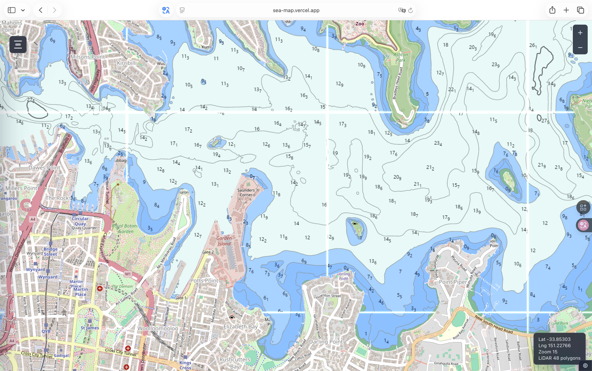
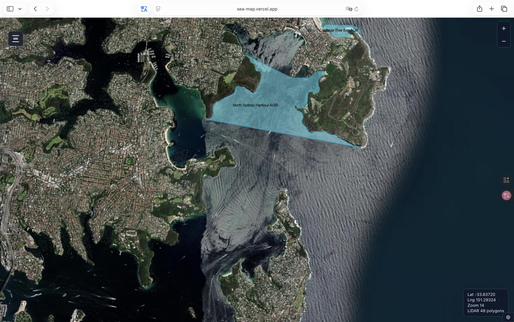
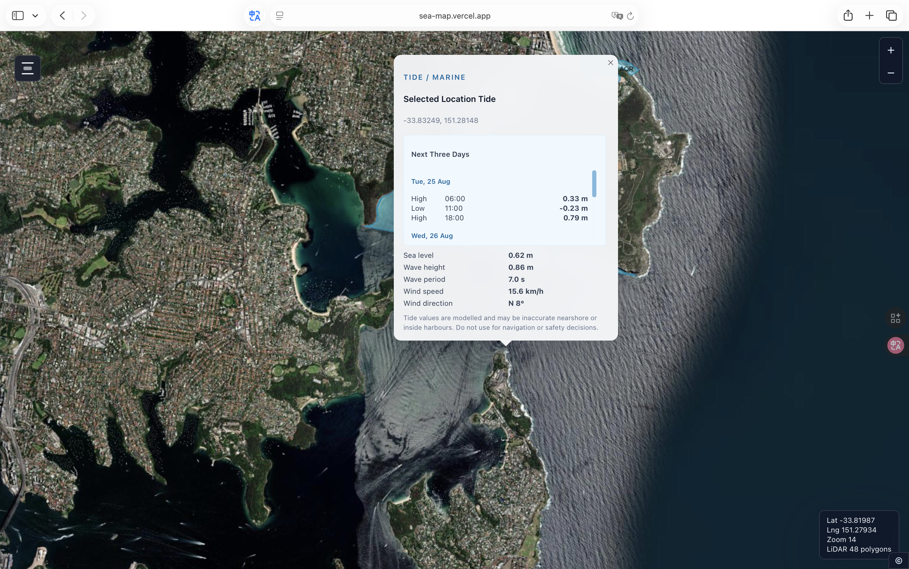
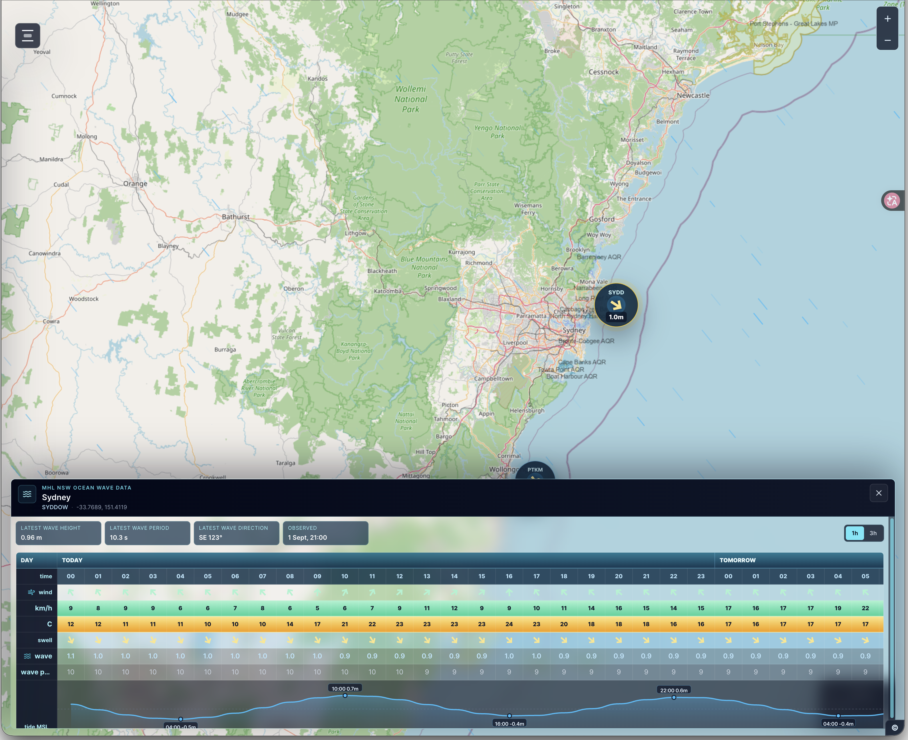

# SeaMap – Australian Marine Mapping and Forecasts

A responsive React and Leaflet web application for Australian bathymetry,
marine protected areas, coastal LiDAR, tides, wave observations and marine forecasts.

Vercel website address: https://seamapau.vercel.app/

## Screenshots

### Bathymetry DEM


### Isobaths at 5m Depth Intervals


### AHO Chart Explorer



### Marine Protected Area



### Tide / Marine Prompt



### Satellite Map


### NSW Coastal and Marine Environmental




## Features

- Street / terrain and high-resolution satellite base maps.
- NSW SEED bathymetry layers:
  - Isobaths at 5m depth intervals
  - Bathymetry DEM - metres
- AHO ENC Online depth soundings.
- AusSeabed national bathymetry raster for non-NSW regions.
- CAPAD marine protected areas by Australian state / territory.
- Marine protected area click query with fishing restriction summary.
- NSW Coastal LiDAR coverage polygons.
- Tide / marine conditions panel:
  - Sea level
  - Today's high / low tides
  - Next three days of high / low tides
  - Wave height
  - Wave period
  - Wind speed
  - Wind direction
- Right-click or long-press the map to query tide / marine conditions for a selected location.
- Responsive glass-style control panel for desktop and mobile.
- Marine Outlook with nationwide coastal location search.
- One-hour and three-hour forecast intervals.
- Hourly wind, swell, wave, water temperature and pressure data.
- Seven official NSW wave buoy markers and detailed forecast panel.
- English, Chinese and system-language modes.
- Current-time indicator in hourly forecast tables.

## Tech Stack

- React
- Vite
- Tailwind CSS
- Leaflet
- React Leaflet
- Esri Leaflet
- Lucide React

## Data Sources

This project uses public data and map services:

- OpenStreetMap base map tiles
- Esri World Imagery satellite tiles
- NSW SEED Marine LiDAR Bathymetry Data 2018
- Geoscience Australia / AusSeabed bathymetry WMS
- CAPAD Marine Protected Areas service
- Open-Meteo Marine Weather API
- Open-Meteo Weather Forecast API
- Manly Hydraulics Laboratory NSW Ocean Wave Data Collection Program for latest NSW wave buoy observations
- Australian Hydrographic Office ENC Online / AHO Chart Explorer
- Tides4Fishing / Nautide marine forecast data (unofficial integration)

Tide values are modelled and may be inaccurate nearshore or inside harbours. They are provided for visual context only and must not be used for navigation or safety-critical decisions.

## NSW Wave Buoys

The app uses the MHL public API for the latest NSW ocean wave buoy observations where a selected location is close to a buoy. The default buoy set matches the MHL Ocean Wave page: Byron Bay, Coffs Harbour, Crowdy Head, Sydney, Port Kembla, Batemans Bay, and Eden.

When MHL observations are unavailable or the selected location is too far from a buoy, the app falls back to Open-Meteo marine wave values.

## Install

```bash
npm install
```

## Run Frontend Only

This starts the frontend only. Marine Outlook requires the FastAPI backend described below.

```bash
npm start
```

or:

```bash
npm run dev
```

Vite will print a local URL such as:

```text
http://localhost:5173/
```

If that port is already in use, Vite will automatically choose another port.

## Build

```bash
npm run build
```

The production build is generated in:

```text
dist/
```

## Preview Production Build

```bash
npm run preview
```

## GitHub Upload Notes


The original Shapefile directory is large and duplicates the converted GeoJSON used by the app. It is usually better to exclude it:

```gitignore
Marine_NSWCoastalLidarCoverage_20190827/
```

The app currently uses `public/data/nsw-lidar-coverage.geojson`, which is about 27 MB. This can be committed if you want the app to run fully from the repository, but it will make the repo larger.

## Attribution

Keep map and data attribution visible when deploying the app. Review the terms of use for OpenStreetMap, Esri, NSW SEED, AusSeabed, CAPAD, Open-Meteo, MHL, the Australian Hydrographic Office, and the Marine Outlook upstream provider.

AHO chart content and all forecast information must not be used for navigation.


## Marine Outlook

The optional **Marine Outlook** layer adds a verified nationwide
location registry, map markers, nearby-station selection, and an hourly marine
forecast table. Its state filter defaults to **All Australia**, so a state does
not need to be selected before searching. Searches with two or more characters
also use the public Tides4Fishing sitemap to discover matching Australian
locations, then validate a bounded number of pages and extract their real
coordinates on demand.

The browser only calls local `/api/marine/*` endpoints. A small FastAPI service
fetches the selected allow-listed Tides4Fishing page, extracts its current
Nautide request parameters, normalizes the response, and caches it. Station
codes, cache keys, and arbitrary upstream URLs are never accepted from the
browser.

When Upstash Redis is configured, the API also stores the complete first
forecast day for each station for three days. The previous day's record is used
only to complete the three-hour pressure comparison around midnight. Add the
following variables to Vercel for Production, Preview, and Development:

```text
KV_REST_API_URL
KV_REST_API_TOKEN
```

Direct Upstash variable names (`UPSTASH_REDIS_REST_URL` and
`UPSTASH_REDIS_REST_TOKEN`) are supported as well. Do not expose either token
through a `VITE_` prefixed variable.

This is an unofficial integration with a third-party public service. Confirm
the provider's current terms and obtain any required permission before public
or commercial deployment. It does not bypass access controls and must not be
used for navigation or as a guarantee of coastal safety.

## Local full-stack development

Create the Python environment once:

```bash
python3.13 -m venv .venv
source .venv/bin/activate
pip install -r requirements.txt
```

Then start the frontend and API together:

```bash
npm install
npm run dev
```


